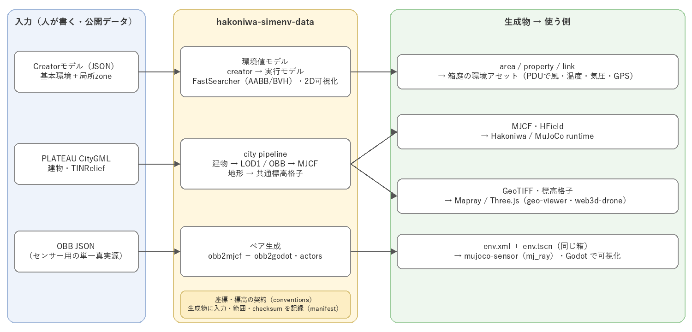

# hakoniwa-simenv-data

Hakoniwaシミュレーションで利用する環境モデルと、PLATEAU 3D都市モデルを
MuJoCo・Mapray・ブラウザ表示向け資産へ変換するツール群です。

環境要因（風、温度、気圧、GPS強度等）を人が編集しやすいCreatorモデルで定義し、
シミュレーションが高速に検索できる実行モデルへ変換します。あわせて、PLATEAU
CityGMLから建物MJCF、地形HField、Mapray用GeoTIFF、ブラウザ用標高格子を同じ
座標契約で生成します。



## 主な機能

- JSON schemaに基づくCreatorモデルと実行モデル
- 基本環境と局所zoneによる風、温度、気圧、GPS強度の定義
- AABB/BVHを使った位置から環境値への高速検索
- 環境データの2D可視化
- ブラウザ用zone editor・mission editor
- PLATEAU CityGML建物の抽出、LOD1近似、OBB化、MJCF生成
- センサー用環境ジオメトリのペア生成（OBB JSON → MuJoCo env.xml ＋ Godot env.tscn）
- 既存MuJoCo機体モデルへの建物geom統合と検証manifest生成
- PLATEAU TINReliefから共通標高格子、MuJoCo HField、GeoTIFF生成
- Mapray Building/DEM Datasetアップロードのplan・実行・状態記録
- Maprayの1回1,000ファイル制約に対応するCityGML/texture分割

## 責任範囲

このリポジトリが担当するもの:

- 環境モデルのschema、生成、検索、可視化
- CityGMLからシミュレーション資産への再現可能な変換
- MuJoCo、Three.js、Mapray間の座標・標高契約
- Mapray Cloudアップロードの安全なplanとクライアント処理

このリポジトリが担当しないもの:

- ドローンの物理計算と飛行制御
- Mapray/Three.js/Leafletのブラウザ表示
- Hakoniwaシミュレーション全体の起動・終了管理
- PLATEAU原本やMapray Cloud Datasetの再配布権限
- Mapray Cloudの契約、費用、API Key/Organization Token管理

生成物の利用先:

- [`hakoniwa-geo-viewer`](https://github.com/hako-community/hakoniwa-geo-viewer)
- [`hakoniwa-web3d-drone`](https://github.com/hako-community/hakoniwa-web3d-drone)
- Hakoniwa/MuJoCo runtime

## ディレクトリ構成

```text
hakoniwa-simenv-data/
|- examples/datasets/                 サンプル環境モデルと生成例
|- examples/sensor_envs/              センサー用OBBジオメトリとenv.xml/env.tscnペア
|- src/hakoniwa_envsim/
|  |- creator/                        Creatorモデル変換
|  |- model/                          実行モデルローダー
|  |- fastsearch/                     AABB/BVH検索
|  |- visualizer2d/                   2D可視化
|  |- asset/                          Hakoniwa PDU統合
|  `- schemas/                        JSON schema
|- src/city_pipeline/                 CityGML/MJCF/terrain変換実装
|- src/gui/                           ブラウザ編集ツール
|- tools/
|  |- city_pipeline.py                Windows向け変換CLI
|  |- mapray_citygml_split.py         CityGML/texture分割
|  |- mapray_b3d_upload.py            Building Dataset操作
|  `- mapray_dem_upload.py            DEM Dataset操作
`- tests/                             unittest
```

## 必要環境

- Python 3.9以上
- 環境モデル機能: `requirements.txt`
- City pipeline: `requirements-city-pipeline.txt`
- MuJoCo検証時は`mujoco==3.8.0`
- Maprayアップロード時はMapray Organization Token

## クローンとセットアップ

```bash
git clone https://github.com/hako-community/hakoniwa-simenv-data.git
cd hakoniwa-simenv-data
python -m venv .venv
```

PowerShell:

```powershell
.\.venv\Scripts\Activate.ps1
python -m pip install --upgrade pip
pip install -r requirements.txt
```

City pipelineも利用する場合:

```powershell
pip install -r requirements-city-pipeline.txt
```

`requirements-city-pipeline.txt`は`requirements.txt`も読み込みます。

## 環境モデル

### Creatorモデルと実行モデル

| レイヤ | 目的 | Schema |
|---|---|---|
| Creatorモデル | 人が編集する環境、grid、base、zones | `environment_model.schema.json` |
| 空間領域 | 3D AABBの集合 | `space_area.schema.json` |
| 環境プロパティ | 風、温度、気圧、GPS等 | `area_properties.schema.json` |
| リンク | areaとpropertyの対応 | `link.schema.json` |
| 境界（任意） | 地面、天井、壁 | `boundary.schema.json` |

Creatorモデルは次の構造を持ちます。

```json
{
  "version": "0.1",
  "meta": {
    "crs": "local-enu",
    "origin_latlon": [34.65436065, 135.16060138],
    "axis": "ENU"
  },
  "grid": {
    "min": [0.0, -6400.0, 0.0],
    "max": [4400.0, 0.0, 100.0],
    "cell_m": [200.0, 200.0, 100.0]
  },
  "base": {
    "wind": { "vector_ms": [4.0, 0.0, 0.0] },
    "temperature_C": 20.0,
    "pressure_atm": 1.0,
    "gps_strength": 1.0
  },
  "zones": []
}
```

zoneは`rect`または`circle`で範囲を定義し、`absolute`、`add`、`scale`、
`turbulence`、`vortex`等の効果を重ねます。詳細例は
`examples/datasets/kobe/environment_model.json`を参照してください。

### Creatorの実行

モジュール相対パスとサンプル設定のため、`src`から実行します。

```powershell
cd src
python -m hakoniwa_envsim.creator.creator `
  --infile ..\examples\datasets\kobe\environment_model.json `
  --outdir ..\examples\datasets\kobe\generated
cd ..
```

生成物:

- `area.json`
- `property.json`
- `link.json`

### 2D可視化

```powershell
cd src
python -m hakoniwa_envsim.visualizer2d.cli `
  --config ..\examples\datasets\kobe\kobe.plot2d.json
cd ..
```

`overlay_map`を有効にすると、contextily経由で指定した地図providerへアクセスします。
providerの利用条件とattributionに従ってください。

### ブラウザ編集ツール

`src/gui/`には次の静的ツールがあります。

- `env_sim_launcher.html`
- `zone_editor.html`
- `mission_editor.html`

```powershell
python -m http.server 18081 --bind localhost --directory src\gui
```

```text
http://localhost:18081/env_sim_launcher.html
```

## PLATEAU city pipeline

### 建物CityGMLからMJCFを生成

```powershell
python tools\city_pipeline.py convert `
  --input <展開済みCityGMLルート> `
  --scenario <city-pipeline.json> `
  --output <生成先> `
  --collide drone
```

入力は`udx/`を直下に持つ展開済みPLATEAU CityGMLです。scenario JSONで次を管理します。

- 原点と座標参照系
- 南北・東西の抽出範囲
- MuJoCo軸契約
- 壁厚、形状近似、衝突bit
- 基準機体MJCF

主な生成物:

- `buildings-lod1.json`
- `buildings-obb.json`
- `buildings.xml`
- 統合済み`drone.xml`
- SHA-256、件数、座標照合を含むmanifest

### PLATEAU TINReliefから共通地形を生成

```powershell
python tools\city_pipeline.py terrain `
  --input <展開済みCityGMLルート> `
  --scenario <city-pipeline.json> `
  --output <生成先>
```

一つのTINRelief入力から次を生成します。

- `terrain-mapray.tif`: Mapray DEM入力用、EPSG:4326/Float32
- `terrain.hfield`: MuJoCo HField
- `terrain-grid.json`: Three.jsとブラウザ判定用標高格子
- `drone-terrain.xml`: HField統合MJCF
- `terrain-manifest.json`: 入力、座標、統計、検証結果

MuJoCo/Three.jsは`modelHeightsM`、Maprayだけが
`modelHeightsM + zBaselineM`を絶対標高として使用します。

## 広域AOIのdry-run

`wide-area-plan`は、運航GeoJSONの境界とローカルPLATEAU原本を照合し、
対象GML・texture量、AOI寸法、Mapray Dataset分割の下限、未充足coverageをJSONへ出力します。
ファイル抽出やMapray Cloud更新は行いません。

```powershell
python tools\city_pipeline.py wide-area-plan `
  --config runtime\windows\scenarios\shibuya\wide-area-5km.json `
  --output runtime\windows\generated\shibuya\wide-area-plan.json
```

`ready_for_mapray_upload`が`false`の場合は、`blocking_reasons`に示された自治体データ等を
追加して再実行します。`minimum_dataset_count_before_citygml_split`はファイル数制約だけを
用いた下限であり、texture参照を保つCityGML分割後は増える場合があります。

## Mapray Cloudツール

`.env.example`を`.env`へコピーし、Organization Tokenをローカルに設定します。
`.env`はGit管理外です。

```dotenv
MAPRAY_ORGANIZATION_TOKEN=your-organization-token
```

### Building Dataset

最初に外部状態を変更しない`plan`を実行します。

```powershell
python tools\mapray_b3d_upload.py plan --input <CityGMLディレクトリ>
```

1,000ファイルを超える場合:

```powershell
python tools\mapray_citygml_split.py `
  --input <textured-citygml.gml> `
  --output <chunk出力先>
```

明示的に新規Datasetを作成する場合:

```powershell
python tools\mapray_b3d_upload.py upload `
  --input <chunk-001> `
  --name <dataset-name> `
  --state <state.json> `
  --wait
```

### DEM Dataset

```powershell
python tools\mapray_dem_upload.py upload `
  --input <terrain-mapray.tif> `
  --name <dataset-name> `
  --wait
```

アップロードコマンドはMapray Cloudに新しい外部状態を作ります。実行前に対象Organization、
保存量、名称、attributionを確認してください。Tokenと署名付きURLはstateへ保存しません。

## センサー用環境ジオメトリ

センシング用途の環境ジオメトリを、**単一真実源のOBB JSON**（ENU: x=East, y=North, z=Up）から
2つのエンジン向けに**ペア生成**します。旧 `hakoniwa-envsim-sensor` を廃止し本リポジトリへ統合したものです。

```
OBB JSON（単一真実源）
  ├─ obb2mjcf  → env.xml   … hakoniwa-mujoco-sensor が mj_ray でセンシング
  └─ obb2godot → env.tscn  … hakoniwa-godot-drone が可視化
```

両出力は定義上**同一の箱**になります（座標変換は `conventions.py` に集約）。

| パス | 内容 |
|---|---|
| `src/city_pipeline/conventions.py` | 座標規約・z正規化・OBB→Godot変換・角点計算・MJCF/TSCNパーサ |
| `src/city_pipeline/obb2godot.py` | OBB JSON → Godot `.tscn`（BoxMesh＋BoxShape3D の StaticBody3D `body_<id>`） |
| `src/city_pipeline/build_pair.py` | OBB JSON → env.xml（obb2mjcf 呼出）＋ env.tscn を一括生成 |
| `src/city_pipeline/actors.py` | 生成済み env.xml に free joint の動的ACTOR body を追加／表示専用ジオメトリを除去 |
| `examples/sensor_envs/` | サンプル OBB（`simple_room` = 床+4壁+柱、`open_field` = 地面のみ）と生成物 `generated/` |
| `tests/test_pair_consistency.py` | env.xml と env.tscn の角点一致を検証（yaw含む） |

```bash
# OBB JSON から env.xml + env.tscn を生成
PYTHONPATH=src/city_pipeline python3 -m build_pair \
  --inp examples/sensor_envs/simple_room/simple_room.obb.json \
  --out-xml /tmp/env.xml --out-tscn /tmp/env.tscn

# 動く物体（ACTOR）を追加。free joint なので qvel が書けて Doppler が出る
PYTHONPATH=src/city_pipeline python3 -m actors \
  --xml /tmp/env.xml --out /tmp/env_actors.xml --actor drone2

# 表示専用ジオメトリ: Godot は描くがセンシング世界からは除去（地面反射でレーダーが埋まるのを防ぐ）
PYTHONPATH=src/city_pipeline python3 -m actors \
  --xml /tmp/env.xml --out /tmp/env_nofloor.xml --actor drone2 --drop ground

# 整合性テスト
python3 tests/test_pair_consistency.py
```

`actors.py` が **mocap body ではなく free joint** を使うのは、MuJoCo の `mj_objectVelocity` が
mocap body には速度 0 を返し、レーダーの Doppler が出なくなるためです。

| フレーム | 軸 |
|---|---|
| OBB JSON（単一真実源） | ENU: x=East, y=North, z=Up |
| MuJoCo（obb2mjcf） | X=North, Y=West(-East), Z=Up |
| Godot（obb2godot） | X=East, Y=Up, Z=North |

## テスト

基本機能:

```powershell
python -m unittest discover -s tests -v
```

City pipelineのテストには`requirements-city-pipeline.txt`の依存関係が必要です。

Schemaを単独検証する場合は、任意で`check-jsonschema`を利用できます。

```powershell
check-jsonschema `
  --schemafile src\hakoniwa_envsim\schemas\environment_model.schema.json `
  examples\datasets\kobe\environment_model.json
```

## データと秘密情報

- `.env`、Organization Token、署名付きURLをコミットしない。
- PLATEAU原本、巨大ZIP、生成途中ディレクトリを安易にGitへ追加しない。
- 生成物には入力、範囲、座標契約、checksum、attributionを記録する。
- Mapray CloudのDataset作成・更新・削除は明示的な確認後に行う。
- PLATEAU、地図provider、Mapray Cloudの利用条件は各公開元に従う。

## 関連資料

- [Hakoniwa Lab - envsim 全体像説明](https://www.docswell.com/s/kanetugu2015/KJQD2M-hakoniwalab-envsim)
- [PLATEAU](https://www.mlit.go.jp/plateau/)
- [Mapray](https://mapray.com/)

## ライセンス

このリポジトリのプロジェクトコードは
[PolyForm Noncommercial License 1.0.0](./LICENSE)で提供します。商用利用は
ライセンサーとの別途契約が必要です。

Python依存パッケージはリポジトリへ同梱せず、利用者が各公開配布元から
インストールします。それぞれのパッケージ、PLATEAUデータ、地図provider、
Mapray Cloudには各公開元のライセンスと利用条件が適用されます。
